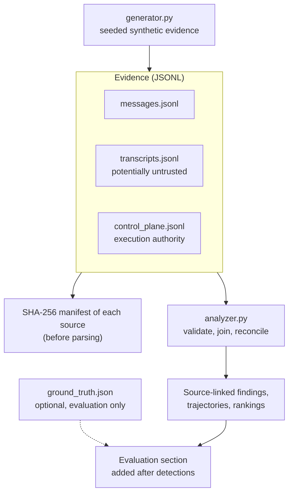

# ORBIT Agent Incident Reconstruction Lab

[](https://github.com/joeyvictorino/orbit-ir/actions/workflows/python-tests.yml)
[](https://www.python.org/)
[](LICENSE)

ORBIT reconstructs a multi-agent incident from independent evidence. It reconciles what agent transcripts claim happened against control-plane execution records, finds agents that coordinated outside their assigned channel, and cites the exact source file and line for every finding. The principle it makes concrete: an agent-authored transcript is a claim, not a record of what executed. The analysis is deterministic (no LLM in the loop), standard-library Python only, and every result is reproducible byte for byte. It ships with a seeded synthetic incident (1,200 agents, 70,000 messages, 84 planted transcript-versus-execution conflicts) and an answer key for scoring.

> **Scope boundary:** This is an original synthetic exercise. It does not claim access to, or prior investigation of, a frontier-lab incident. Perfect scores on the supplied fixture validate deterministic recovery of generated facts. They are not production-performance or model-intent claims. Status: alpha.

## Quickstart

Needs Python 3.10 or newer and nothing else (standard library only). Run from the repository root; every command below was run from a clean clone.

```bash
git clone https://github.com/joeyvictorino/orbit-ir
cd orbit-ir
python3 -m orbit_ir.cli demo --workdir work     # generate the fixture, analyze it, evaluate it (takes a few seconds)
```

This writes synthetic evidence to `work/evidence/` and findings to `work/results/` (start with `work/results/report.md`), and prints the summary as JSON. Regenerated results match the committed [`artifacts/full_scale/`](artifacts/full_scale/) byte for byte except the informational `runtime_seconds` field.

Analyze an evidence directory without an answer key:

```bash
python3 -m orbit_ir.cli analyze --input work/evidence --out work/independent-results
```

Evaluate those independent detections against the synthetic fixture afterwards:

```bash
python3 -m orbit_ir.cli analyze \
  --input work/evidence \
  --out work/evaluated-results \
  --ground-truth work/evidence/ground_truth.json
```

A 40-agent miniature is in [`examples/sample_evidence/`](examples/sample_evidence/) (500 messages, 80 transcripts), with its evaluated output in `examples/sample_results/`. Malformed input exits with status 2 and a message naming the file and line, for example `error: messages.jsonl:1: invalid JSON: ...`.

Print the JSON Schema that describes the `summary.json` output:

```bash
python3 -m orbit_ir.cli schema
```

The schema is also available at [`docs/analysis-schema.json`](docs/analysis-schema.json). Use it to validate output or generate types in other languages.

Optionally, `pip install .` adds an `orbit-ir` command with the same subcommands.

## Reading

- [ORBIT technical report (4-page PDF)](docs/ORBIT_Agent_Incident_Work_Sample.pdf)
- [Below the transcript](docs/transcript-is-a-claim-openai-hf-incident.md): a longer essay applying the same idea to a published agent incident. It states its own scope: a public-record analysis and proposed evidence method, not a re-investigation.

## Investigation question

Can independent telemetry establish which agents coordinated outside their assigned channel, which transcript records conflict with actual tool execution, and what identities, credentials, resources, effects, and control decisions were involved?

## Commands

All commands are available as `python3 -m orbit_ir.cli <command>` or (after `pip install .`) as `orbit-ir <command>`.

### Core analysis

| Command | Description |
| --- | --- |
| `demo` | Generate and analyze a full deterministic exercise in one step |
| `generate` | Generate deterministic synthetic evidence with configurable parameters |
| `analyze` | Analyze evidence and write source-linked findings, trajectories, and reports |
| `schema` | Print the JSON Schema for the analysis summary output |

### Evidence inspection

| Command | Description |
| --- | --- |
| `stats` | Print summary statistics for an evidence dataset (record counts, time window, agent count) |
| `timeline` | Merge evidence into a single chronological event stream with optional agent/source filters |
| `validate` | Validate evidence format and cross-file integrity (schema, timestamps, referential consistency) |
| `verify` | Verify evidence integrity against a SHA-256 manifest |
| `scope` | Filter evidence by time window, agent set, or source before analysis |
| `merge` | Merge multiple evidence directories into one |

### Post-analysis

| Command | Description |
| --- | --- |
| `diff` | Compare two analysis results directories (added/removed/changed findings) |
| `fingerprint` | Compute agent behavior fingerprints and anomaly scores |
| `correlate` | Cross-link events across evidence sources by agent and time window |
| `export` | Convert findings to CSV, CEF, SARIF, or JSON without re-analyzing |
| `summary` | Generate an executive summary from analysis results |

### Analyze flags

The `analyze` command accepts several output and filtering flags:

```bash
orbit-ir analyze --input evidence/ --out results/ \
  --ground-truth evidence/ground_truth.json \
  --format sarif \
  --min-confidence high \
  --min-severity medium \
  --detection-type tool-name-mismatch,unbacked-completion \
  --agent agent_0001,agent_0002 \
  --comm-graph \
  --heatmap --heatmap-bucket 30 \
  --navigator-layer \
  --evidence-chain
```

| Flag | Values | Description |
| --- | --- | --- |
| `--format` | `json`, `sarif`, `html`, `csv`, `cef` | Output format (default: `json`). SARIF for GitHub Code Scanning, CEF for SIEM ingestion, HTML for browser-readable report |
| `--min-confidence` | `low`, `medium`, `high` | Only include findings at or above this confidence level |
| `--min-severity` | `low`, `medium`, `high`, `critical` | Only include findings at or above this severity level |
| `--detection-type` | comma-separated | Filter to specific detection types (e.g. `tool-name-mismatch`, `unbacked-completion`, `oracle-integrity`) |
| `--agent` | comma-separated | Filter findings to specific agent IDs |
| `--comm-graph` | flag | Export agent communication graph as DOT to `comm_graph.dot` |
| `--heatmap` | flag | Export agent activity heatmap as JSON to `heatmap.json` |
| `--heatmap-bucket` | minutes | Bucket size for heatmap (default: 60) |
| `--navigator-layer` | flag | Export findings as a MITRE ATT&CK Navigator layer |
| `--evidence-chain` | flag | Print the cryptographic evidence chain (hash-linked findings to evidence) |

## Architecture



| Module | Role |
| --- | --- |
| `orbit_ir/generator.py` | Seeded, deterministic synthetic evidence plus an answer key |
| `orbit_ir/analyzer.py` | Schema and timestamp validation, joins, integrity checks, findings, report rendering |
| `orbit_ir/schema.py` | JSON Schema for the analysis summary output |
| `orbit_ir/cli.py` | CLI dispatcher: 15 subcommands and error reporting |
| `orbit_ir/stats.py` | Evidence dataset summary statistics (record counts, time windows, agent sets) |
| `orbit_ir/diff.py` | Structural diff between two analysis result sets |
| `orbit_ir/validate.py` | Evidence format and cross-file integrity validation |
| `orbit_ir/merge.py` | Evidence directory merging with deduplication |
| `orbit_ir/timeline.py` | Chronological event stream across all evidence sources |
| `orbit_ir/comm_graph.py` | Agent communication graph construction and DOT export |
| `orbit_ir/heatmap.py` | Agent activity heatmap with configurable time buckets |
| `orbit_ir/fingerprint.py` | Agent behavior fingerprinting and anomaly scoring |
| `orbit_ir/correlate.py` | Cross-source event correlation by agent and time window |
| `orbit_ir/cef.py` | Common Event Format (CEF) export for SIEM ingestion |
| `orbit_ir/sarif.py` | SARIF 2.1.0 output for GitHub Code Scanning |
| `orbit_ir/html_report.py` | HTML report rendering |
| `orbit_ir/export.py` | Standalone format conversion (CSV, CEF, SARIF, JSON) without re-analysis |
| `orbit_ir/scope.py` | Evidence scope filtering by time window, agent set, or source |
| `orbit_ir/summary.py` | Executive summary generation from analysis results |

Ground truth is not required for analysis. When supplied, it is consulted only after detections are complete and adds an evaluation section without changing any finding.

### Full-scale fixture

The default seeded generator creates:

| Record class | Count |
| --- | ---: |
| Agents | 1,200 |
| Message events | 70,000 |
| Transcript records | 1,300 |
| Independent control-plane events | 1,300 |
| Agents on the unsanctioned channel | 700 |
| Deliberate transcript/tool conflicts | 84 |
| Unbacked completions (claim done, check failed) | 30 |
| Oracle integrity violations (test expectation modified) | 12 |
| High-volume assignment coordinators | 6 |

The committed `artifacts/full_scale/` outputs were generated from this fixture. Raw full-scale evidence is regenerated locally to keep the repository small.

### Detection and evidence controls

- Reconciles transcript claims to independent control-plane execution records.
- Detects unbacked completions: agent claims task done but independent check failed.
- Detects oracle integrity violations: agent modifies protected test expectations.
- Detects credential reuse: flags workload credentials shared across multiple agents.
- Detects missing transcript and control-plane records.
- Detects duplicate tool-call and message identifiers instead of silently overwriting them.
- Detects agent-identity and trace-identity disagreement across sources.
- Validates JSON objects, required fields, and timezone-aware ISO-8601 timestamps with exact source-line errors.
- Hashes each source with SHA-256 before parsing.
- Emits source file and line references in findings and trajectories.
- Normalizes the investigation window to UTC.
- Keeps factual extraction, joins, integrity checks, and findings deterministic.
- Maps findings to MITRE ATT&CK techniques with Navigator layer export.
- Computes agent behavior fingerprints and anomaly scores.
- Correlates events across evidence sources by agent and time window.
- Builds agent communication graphs and activity heatmaps.
- Exports findings as CEF for SIEM ingestion (Splunk, ArcSight, ELK).
- Cryptographic evidence chain links findings to evidence via SHA-256 hashes.

Evidence path followed by each trajectory:

```text
workload identity -> agent -> tool call -> credential -> resource -> effect -> control decision
```

### Generated outputs

| File | Purpose |
| --- | --- |
| `summary.json` | Corpus, findings, method, limitations, and optional evaluation |
| `findings.csv` | Record conflicts with exact source files and lines |
| `findings.json` | Machine-readable findings with full metadata |
| `findings.sarif` | SARIF 2.1.0 for GitHub Code Scanning integration |
| `findings.cef` | CEF for SIEM ingestion (Splunk, ArcSight, ELK) |
| `trajectories.json` | Identity-to-effect paths with supporting source references |
| `coordinator_ranking.json` | Assignment-volume ranking using an explicit threshold (`--coordinator-min-assignments`, default 2) |
| `credential_reuse.json` | Workload credentials shared across multiple agents |
| `data_quality.json` | Duplicate message identifiers and integrity observations |
| `evidence_manifest.json` | SHA-256 evidence inventory and role labels |
| `evidence_chain.json` | Cryptographic hash chain linking findings to evidence |
| `report.md` | Concise decision-grade findings and caveats |
| `report.html` | Browser-readable HTML report with the same content |
| `comm_graph.dot` | Agent communication graph in DOT format (with `--comm-graph`) |
| `heatmap.json` | Agent activity heatmap (with `--heatmap`) |
| `navigator_layer.json` | MITRE ATT&CK Navigator layer (with `--navigator-layer`) |

## Tests

```bash
python3 -m pytest tests/ -v              # 233 tests
pip install ruff==0.17.0 && ruff check . # lint, rules in pyproject.toml
```

The tests are adversarial regressions: malformed JSON with the exact line number, missing transcripts, duplicate tool-call identifiers, identity and trace swaps, unbacked-completion detection, oracle-modification detection, credential-reuse detection, analysis without ground truth, deterministic generation, unsafe generator configuration, CLI error reporting, evidence validation, evidence diffing, statistics, merging, timeline construction, behavior fingerprinting, cross-source correlation, CEF/SARIF/HTML/CSV export, scope filtering, and executive summary generation. CI ([`python-tests.yml`](.github/workflows/python-tests.yml)) runs them on Python 3.10 to 3.14, reruns the full exercise, diffs it against `artifacts/full_scale/`, checks that analysis works with the answer key removed, and runs the linter.

## What it does not do

- It does not analyze real production telemetry. Synthetic evidence is cleaner than production logs, and stable tool-call identifiers make reconciliation easier than it would be in practice.
- It does not infer intent. Findings are record conflicts, not statements about why an agent behaved as it did.
- It does not prove that a source system told the truth. Hash manifests show integrity after acquisition, not the truthfulness of the originating system.
- It is not a detection product. The coordinator threshold is explicit and scenario-specific, and the fixture scores are not expected production accuracy.
- It uses no LLM for extraction, joins, hashing, schema validation, mismatch detection or findings. A model could summarize records the pipeline already cited, but generated prose would never become evidence.
- It demonstrates forensic mechanics, not frontier-model interpretability or RL post-training.

## Contributing and security

See [CONTRIBUTING.md](CONTRIBUTING.md) and [SECURITY.md](SECURITY.md).

## Author

Joey Victorino  
Cyberforensics, incident response, and AI agent security  
[joeyvictorino.com](https://joeyvictorino.com/) | [LinkedIn](https://www.linkedin.com/in/joeyvictorino/)

## License

MIT, see [LICENSE](LICENSE).
