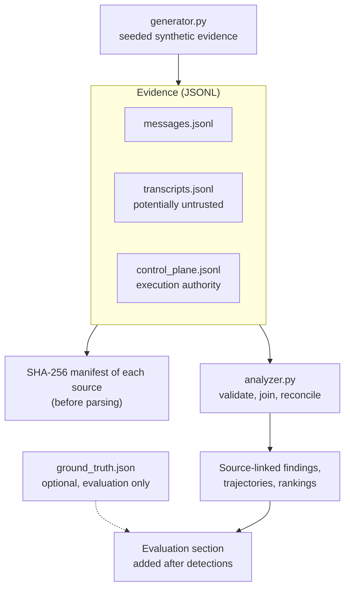

# ORBIT Agent Incident Reconstruction Lab

[](https://github.com/joeyvictorino/orbit-ir/actions/workflows/python-tests.yml)
[](https://www.python.org/)
[](LICENSE)

ORBIT is a small, dependency-free Python tool that generates a synthetic multi-agent incident and then reconstructs it from the evidence. It reconciles what agent transcripts claim happened against independent control-plane execution records, finds agents that coordinated outside their assigned channel, and writes every finding with the exact source file and line it came from. It exists to make one forensic principle concrete for agent systems: an agent-authored transcript is a claim, not automatically a record of what executed. The analysis is deterministic (no LLM in the loop), so every result can be reproduced and checked.

> **Scope boundary:** This is an original synthetic exercise. It does not claim access to, or prior investigation of, a frontier-lab incident. Perfect scores on the supplied fixture validate deterministic recovery of generated facts. They are not production-performance or model-intent claims. Status: alpha.

## Quickstart

Needs Python 3.10 or newer and nothing else (standard library only). Run from the repository root; every command below was run from a clean clone.

```bash
git clone https://github.com/joeyvictorino/orbit-ir
cd orbit-ir
python3 -m orbit_ir.cli demo --workdir work     # generate the fixture, analyze it, evaluate it (takes a few seconds)
```

This writes synthetic evidence to `work/evidence/` and findings to `work/results/` (start with `work/results/report.md`), and prints the summary as JSON. Regenerated results match the committed [`artifacts/full_scale/`](artifacts/full_scale/) byte for byte except the informational `runtime_seconds` field.

Analyze an evidence directory without an answer key:

```bash
python3 -m orbit_ir.cli analyze --input work/evidence --out work/independent-results
```

Evaluate those independent detections against the synthetic fixture afterwards:

```bash
python3 -m orbit_ir.cli analyze \
  --input work/evidence \
  --out work/evaluated-results \
  --ground-truth work/evidence/ground_truth.json
```

A 40-agent miniature is in [`examples/sample_evidence/`](examples/sample_evidence/) (500 messages, 80 transcripts), with its evaluated output in `examples/sample_results/`. Malformed input exits with status 2 and a message naming the file and line, for example `error: messages.jsonl:1: invalid JSON: ...`.

Optionally, `pip install .` adds an `orbit-ir` command with the same subcommands (`generate`, `analyze`, `demo`).

## Reading

- [ORBIT technical report (4-page PDF)](docs/ORBIT_Agent_Incident_Work_Sample.pdf)
- [Below the transcript](docs/transcript-is-a-claim-openai-hf-incident.md): a longer essay applying the same idea to a published agent incident. It states its own scope: a public-record analysis and proposed evidence method, not a re-investigation.

## Investigation question

Can independent telemetry establish which agents coordinated outside their assigned channel, which transcript records conflict with actual tool execution, and what identities, credentials, resources, effects, and control decisions were involved?

## Architecture



| Module | Role |
| --- | --- |
| `orbit_ir/generator.py` | Seeded, deterministic synthetic evidence plus an answer key |
| `orbit_ir/analyzer.py` | Schema and timestamp validation, joins, integrity checks, findings, report rendering |
| `orbit_ir/cli.py` | `generate`, `analyze`, `demo` subcommands and error reporting |

Ground truth is not required for analysis. When supplied, it is consulted only after detections are complete and adds an evaluation section without changing any finding.

### Full-scale fixture

The default seeded generator creates:

| Record class | Count |
| --- | ---: |
| Agents | 1,200 |
| Message events | 70,000 |
| Transcript records | 1,300 |
| Independent control-plane events | 1,300 |
| Agents on the unsanctioned channel | 700 |
| Deliberate transcript/tool conflicts | 84 |
| High-volume assignment coordinators | 6 |

The committed `artifacts/full_scale/` outputs were generated from this fixture. Raw full-scale evidence is regenerated locally to keep the repository small.

### Detection and evidence controls

- Reconciles transcript claims to independent control-plane execution records.
- Detects missing transcript and control-plane records.
- Detects duplicate tool-call and message identifiers instead of silently overwriting them.
- Detects agent-identity and trace-identity disagreement across sources.
- Validates JSON objects, required non-empty string fields, optional recipient identifiers, and timezone-aware ISO-8601 timestamps with exact source-line errors.
- Hashes each source with SHA-256 before parsing.
- Emits source file and line references in findings and trajectories.
- Normalizes the investigation window to UTC.
- Keeps factual extraction, joins, integrity checks, and findings deterministic.

Evidence path followed by each trajectory:

```text
workload identity -> agent -> tool call -> credential -> resource -> effect -> control decision
```

### Generated outputs

| File | Purpose |
| --- | --- |
| `summary.json` | Corpus, findings, method, limitations, and optional evaluation |
| `findings.csv` | Record conflicts with exact source files and lines |
| `trajectories.json` | Identity-to-effect paths with supporting source references |
| `coordinator_ranking.json` | Assignment-volume ranking using an explicit threshold (`--coordinator-min-assignments`, default 2) |
| `data_quality.json` | Duplicate message identifiers and integrity observations |
| `evidence_manifest.json` | SHA-256 evidence inventory and role labels |
| `report.md` | Concise decision-grade findings and caveats |

## Tests

```bash
python3 -m unittest discover -s tests -v    # 11 tests
pip install ruff==0.17.0 && ruff check .    # lint, rules in pyproject.toml
```

The tests are adversarial regressions: malformed JSON with the exact line number, missing transcripts, duplicate tool-call identifiers, identity and trace swaps, analysis without ground truth, deterministic generation, unsafe generator configuration, and CLI error reporting. CI ([`python-tests.yml`](.github/workflows/python-tests.yml)) runs them on Python 3.10 to 3.14, reruns the full exercise, diffs it against `artifacts/full_scale/`, checks that analysis works with the answer key removed, and runs the linter.

## What it does not do

- It does not analyze real production telemetry. Synthetic evidence is cleaner than production logs, and stable tool-call identifiers make reconciliation easier than it would be in practice.
- It does not infer intent. Findings are record conflicts, not statements about why an agent behaved as it did.
- It does not prove that a source system told the truth. Hash manifests show integrity after acquisition, not the truthfulness of the originating system.
- It is not a detection product. The coordinator threshold is explicit and scenario-specific, and the fixture scores are not expected production accuracy.
- It uses no LLM for extraction, joins, hashing, schema validation, mismatch detection or findings. A model could summarize records the pipeline already cited, but generated prose would never become evidence.
- It demonstrates forensic mechanics, not frontier-model interpretability or RL post-training.

## Contributing and security

See [CONTRIBUTING.md](CONTRIBUTING.md) and [SECURITY.md](SECURITY.md).

## Author

Joey Victorino  
Cyberforensics, incident response, and AI agent security  
[joeyvictorino.com](https://joeyvictorino.com/) | [LinkedIn](https://www.linkedin.com/in/joeyvictorino/)

## License

MIT, see [LICENSE](LICENSE).
